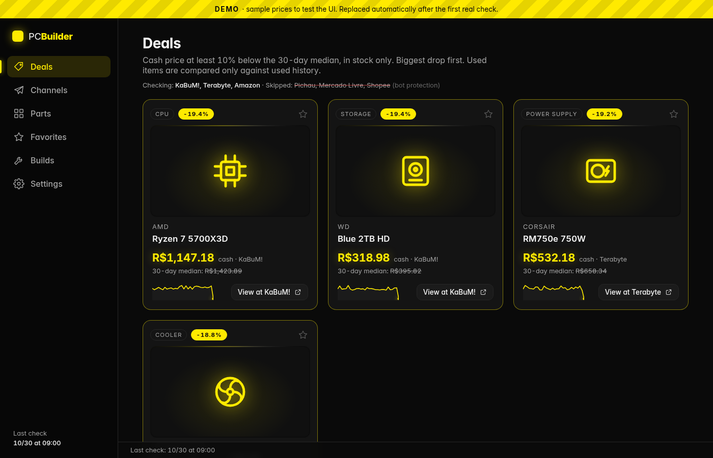
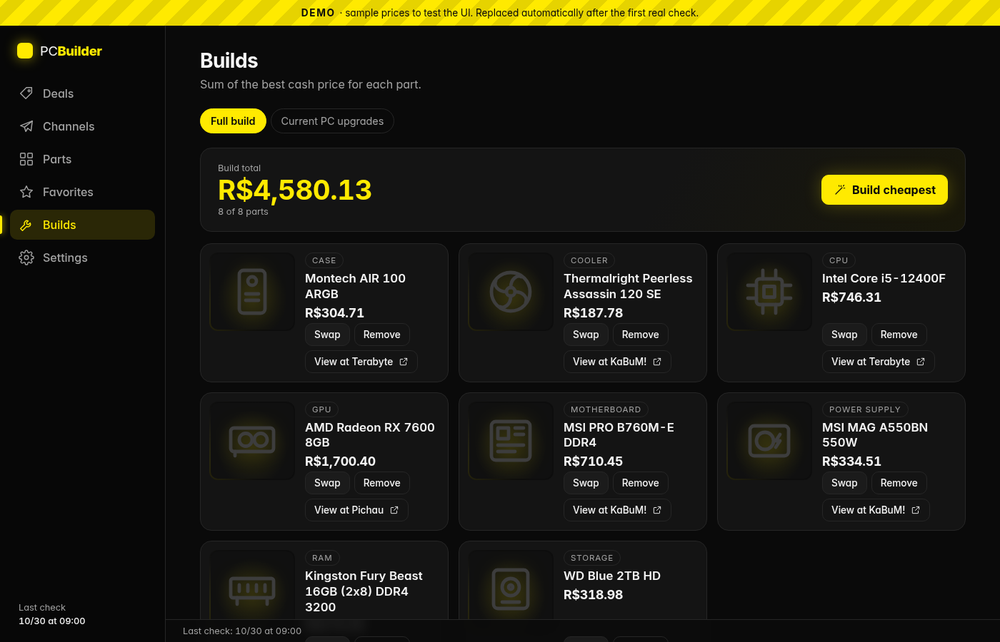
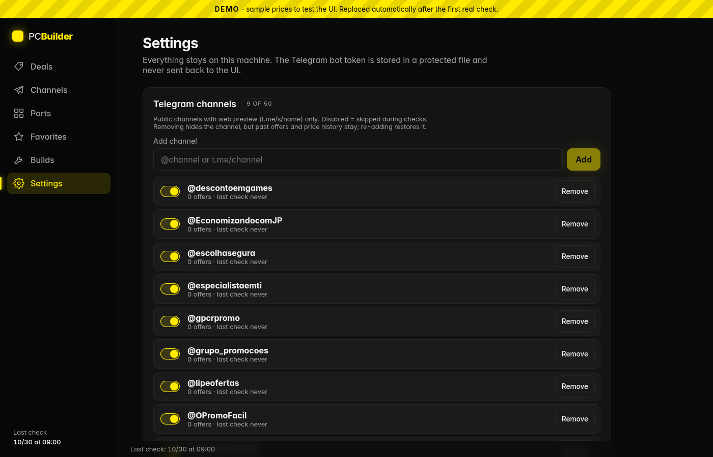

# PC Builder

**English** · [Português (Brasil)](README.pt-BR.md)

A local, self-hosted dashboard that tracks PC part prices from Brazilian stores and from public Telegram deal
channels, keeps the price history, and highlights real deals (price below the 30-day median). It also builds the
cheapest compatible full PC and lists upgrades compatible with your current PC. Dark UI, bilingual interface in Portuguese and English (selectable in Settings > Language; defaults to pt-BR; backend messages remain in Portuguese).

The **Settings** screen (gear icon) controls channels, stores, your current PC, price range, alerts through your
own Telegram bot, the internal scheduler, and language. It runs locally, with Docker compose, or scheduled by Hermes
Agent (see [docs/en/HERMES.md](docs/en/HERMES.md)).

## Screenshots

Sample data (the app starts with an example database until the first real price is collected).

| Deals | Builds |
|---|---|
|  |  |



## Architecture

```
 stores (KaBuM!, Terabyte, Amazon)        public Telegram channels (t.me/s/<channel>)
            │  app.collect (scheduled)              │  app.tg (scheduled, every ~45 min)
            ▼                                       ▼
        parse price ──► app.ingest ──►  SQLite (data/pcbuilder.db)  ◄── classify type
                                                    │                    (rules + optional local Ollama)
                                                    ▼
                         FastAPI (read-only API + builds/favorites) on 127.0.0.1:8787
                                                    │
                                                    ▼
                                React + Vite UI (served by the backend)
```

- **Prices never enter through the HTTP API**: only the local `app.ingest` command and the collectors write prices.
- The AI (optional, local Ollama) only says the item *type*; price and "same product" are plain, tested rules.
- Alerts go to the target chosen in Settings: **your Telegram bot**, **script output** (stdout; whatever schedules
  the script delivers it, e.g. cron or Hermes Agent) or none. Empty output = nothing to report.

## Requirements

- Linux or macOS, Python 3.11 and [uv](https://docs.astral.sh/uv/)
- Node.js 20+ and npm (to build the UI)
- Optional: [Ollama](https://ollama.com/) with small models for the Telegram channel classifier. Without it, the
  app uses rules (see "Local AI" below)

## Run locally

```sh
git clone <repository-url> pc-builder && cd pc-builder
cd frontend && npm ci && npm run build && cd ..
cd backend && uv sync && uv run python -m app.serve
```

Open <http://127.0.0.1:8787>. Until the first real price is collected, the app shows **sample data** (yellow
"EXEMPLO" banner). To collect real prices:

```sh
cd backend
uv run python -m app.collect --dry-run     # stores: show what would be saved
uv run python -m app.collect               # stores: save
uv run python -m app.tg                    # Telegram channels
```

Optional variables are listed in `.env.example`.

## Getting alerts on Telegram

Everything happens on screen, in **Settings → Notification** (or **Notificação** in Portuguese):

1. In Telegram, open **@BotFather** and send `/newbot`. Pick a name; it replies with the bot **token** (one line:
   digits, a colon and about 35 letters/digits).
2. Paste the token in "Bot token" ("Token do bot") and click **Save** (**Salvar**). From then on the screen only shows "configured (ends in …1234)": the token lives in `data/secrets.env` (mode 0600), never in the database, never sent back by the API.
3. Open your bot in Telegram and send `/start`.
4. Click **Find my chat** (**Encontrar meu chat**) and pick your conversation. Then **Send test message** (**Enviar mensagem de teste**).
5. Set "Alert target" ("Destino do aviso") to **Telegram bot** (**Bot do Telegram**) and save.

Rather not paste the token in the browser? Set `PCB_TELEGRAM_TOKEN` and `PCB_TELEGRAM_CHAT_ID` in the service
environment (they win over the file; the field becomes read-only).

## Local AI (Ollama): optional, can be turned on later

Without Ollama, the type of each channel offer comes from **rules** (99.7% right on the hand-labelled samples, an
optimistic number: the samples are small and the rules were tuned on them). To use the AI, with nothing to reinstall:

1. Install Ollama ([ollama.com/download](https://ollama.com/download)) and keep it running.
2. In **Settings → IA local (Ollama)**, check that it says "Ollama responde" (default address
   `http://127.0.0.1:11434`; change it and click **Testar** if yours is different).
3. Under "Baixar outro modelo" (download another model), download a model (the bar shows progress) and tick 1 to 3
   in the list. Click **Salvar modelos**.
4. Keep the mode on **Automático**: the app uses the AI when Ollama answers and falls back to the rules by itself if
   it goes down (one notice per outage; when it is back, what the rules classified is re-checked).

Suggested (tested) models: `qwen2.5:3b` (~2 GB), `llama3.2:3b` (~2 GB), `gemma3:4b` (~3.3 GB). With 1 model it
decides alone; with 2, both must agree; with 3, the majority wins (the most accurate in the tests). Only one model
sits on the GPU at a time: plan for roughly 3 to 5 GB of video memory for these (Ollama runs what does not fit on the
CPU); without a GPU everything runs on the CPU (much slower, ~2 to 7 s per post on a typical desktop PC). The
"Teste rápido" (quick test) box shows the type of a pasted title and where it came from.

## Who runs the collection: two modes (pick one)

- **Internal scheduler** (no cron): in **Settings → Coleta**, turn on "Agendador interno" (or `PCB_SCHEDULER=1`).
  The server itself (`app.serve`) runs the store collection and the channel round every "Coletar a cada" minutes and
  sends the alerts to the chosen target. "Rodar agora" runs one round right away.
- **External scheduler** (cron, systemd timer, Hermes Agent): keep the internal scheduler **off** (otherwise it
  runs twice) and schedule `deploy/coleta-diaria.sh` and `deploy/canais-telegram.sh`. With the **script output**
  target the message is printed to stdout and the scheduler delivers it; with **Telegram bot** the app sends it and
  the output stays empty. Systemd user-service template: `deploy/pc-builder.service`.

In both modes a file lock (`data/rodada.lock`) prevents two rounds at the same time. **Game mode** (on screen or
`PCB_GAME_MODE=1`) skips the round while a game is open (local install only, not in Docker).

The server only listens on `127.0.0.1` (inside Docker it listens on `0.0.0.0` *in the container*, and compose
publishes it on the host's `127.0.0.1` only: see "Docker"). To reach it from another device, put a local reverse
proxy in front of it (e.g. `tailscale serve` inside a private network). Never publish it on `0.0.0.0` without a
proxy and never expose it to the internet.
Every request that writes (settings, token, channels, builds, favorites) must come with an allowed `Host` and, if present,
an allowed `Origin` (default `127.0.0.1:8787` and `localhost:8787`); add your proxy's host name to
`PCB_ALLOWED_HOSTS`, or saving from the other device returns 403.

## Docker

Needs Docker with the compose plugin. No Python, Node or uv on the host.

```sh
git clone <repository-url> pc-builder && cd pc-builder
cp .env.example .env          # optional: without a .env it also starts
docker compose up -d --build
```

Open <http://127.0.0.1:8787>. The internal scheduler is **on by default** in Docker (`PCB_SCHEDULER=1`); set
`PCB_SCHEDULER=0` in `.env` to turn it off. Look at the logs with `docker compose logs -f pc-builder`.

- **Where the data lives:** in the named volume `pcb-data`, mounted at `/data` (`PCB_DATA_DIR`): database, channel
  photos, `secrets.env` (mode 0600), `agendador.json`, `rodada.lock`. The volume is created owned by the container
  user (UID 10001, not root), so it works from scratch with no `sudo` and no `chmod`. Nothing from `data/`, `.env`
  or secrets is ever copied into the image (see `.dockerignore`).
- **Stop / start / update:**
  ```sh
  docker compose stop            # stop (keeps everything)
  docker compose down            # remove the container; the data volume stays
  git pull && docker compose up -d --build   # update; the data is kept
  docker compose down -v         # DELETES the data volume (database, token): only if you mean it
  ```
- **Back up the volume** (a tar.gz in the current folder; uses the small `alpine` image):
  ```sh
  docker compose stop
  docker run --rm -v pc-builder_pcb-data:/data:ro -v "$PWD":/backup alpine tar czf /backup/pcb-data.tar.gz -C /data .
  docker compose start
  ```
  The volume name is `<project>_pcb-data`; check it with `docker volume ls` (the project is the folder name).
  To restore, stop the app and extract the file back into the volume with the same command pattern.
- **Hardening already on:** non-root user, `read_only` filesystem (writes only in `/data` and a `tmpfs` at `/tmp`),
  `cap_drop: [ALL]`, `no-new-privileges`, log rotation (3 × 10 MB), image healthcheck on `/api/health`.
- **Only the host's loopback:** the container listens on `0.0.0.0` (otherwise the published port cannot reach it),
  but compose publishes it as `127.0.0.1:8787:8787`. **Do not change it to `8787:8787`.** Prices still never enter
  through the API, and the write lock (Host/Origin/Content-Type) is the same as outside Docker.
- **Game mode** does not exist in Docker (the container cannot see your processes); the screen says so.

### Telegram bot in Docker

Either on screen (**Settings → Notification** / **Notificação**; it writes `/data/secrets.env`, mode 0600, in the volume) or in
`.env` with `PCB_TELEGRAM_TOKEN` and `PCB_TELEGRAM_CHAT_ID` (they win over the file and the field becomes read-only).
Never commit `.env`.

### Ollama (optional profile)

```sh
docker compose --profile ollama up -d
```

This also starts an `ollama/ollama` container with its own volume for models. It does **not** publish any port on
the host: only the app reaches it, over the compose network, at `http://ollama:11434`. Tell the app where it is,
either in `.env` (`PCB_OLLAMA_URL=http://ollama:11434`, and optionally `COMPOSE_PROFILES=ollama` so a plain
`docker compose up -d` starts it too; the field then shows as locked by the environment) or by typing that address
in **Settings → IA local (Ollama)** and clicking **Testar**/**Salvar**. Then download a model on that same screen
(the bar shows progress). **Without a GPU Ollama is slow**; the `rules` classifier is the recommended mode then
(Settings → IA local → "Só regras"). For an NVIDIA GPU, uncomment the `deploy.resources.reservations.devices`
block in `docker-compose.yml` (needs the NVIDIA Container Toolkit on the host). The official Ollama image runs as
root inside its own container; it has no published port and no access to your files.

### Reaching it from another device (at your own risk)

Keep the `127.0.0.1` publication and put a reverse proxy **on the host** in front of it (e.g. `tailscale serve`,
Caddy or nginx with authentication, inside a private network). Add the host name the browser uses to
`PCB_ALLOWED_HOSTS` in `.env` (exact match, e.g. `pc.my-tailnet.example`), otherwise saving returns 403. Never
publish the port on `0.0.0.0` without a proxy and never expose it to the internet.

### Environment variables that matter in Docker

| Variable | Default in Docker | What it does |
|---|---|---|
| `PCB_HOST` | `0.0.0.0` (set by the image) | Listen address; outside Docker the default is `127.0.0.1`. Invalid value = `127.0.0.1` |
| `PCB_IN_DOCKER` | `1` (set by the image) | Turns game mode off and tells the screen it is in Docker |
| `PCB_DATA_DIR` | `/data` | Database, photos, `secrets.env`, scheduler state and lock |
| `PCB_SCHEDULER` | `1` (compose) | Internal scheduler on/off |
| `PCB_ALLOWED_HOSTS` | empty | Extra `Host`/`Origin` names allowed to write (your proxy) |
| `PCB_PANEL_URL` | `http://127.0.0.1:8787` | Link at the end of alerts |
| `PCB_TELEGRAM_TOKEN`, `PCB_TELEGRAM_CHAT_ID` | empty | Bot (win over the screen's `secrets.env`) |
| `PCB_OLLAMA_URL`, `PCB_OLLAMA_MODELS` | empty | Ollama address / models (`http://ollama:11434` with the profile) |
| `PCB_CLASSIFIER` | `auto` | `auto`, `rules` or `ollama` |
| `PCB_COLLECT_EVERY_MINUTES`, `PCB_STORES`, `PCB_NOTIFY_TARGET`, `PCB_CURRENT_PC` | screen's value | See `.env.example` |

## Tests

```sh
cd backend && uv run python -B -m pytest -q     # backend
cd frontend && npx vitest run                   # frontend
python3 tools/check_public.py                   # public hygiene: no personal data or secrets in the repo
```

## Documentation

Full documentation in English in [docs/en/](docs/en/) and in Portuguese in [docs/](docs/):

- [Database](docs/en/01-banco-de-dados.md): tables, queries, design rules.
- [Backend and API](docs/en/02-backend.md): endpoints, write guard, why prices never enter through the network.
- [Frontend](docs/en/03-frontend.md): views, settings screen, demo mode.
- [Price collection](docs/en/04-coleta-de-precos.md): supported stores, how the collector works, scheduling.
- [Telegram channels](docs/en/05-canais-telegram.md): reading public channels, classifying and alerting.
- [Hermes Agent](docs/en/HERMES.md): scheduling with a Hermes Agent cron (optional).

## Scraping disclaimer

Collecting prices from store websites can **break at any time** (sites change) and **may violate a site's terms
of use**. This project is for **personal use**, at low volume, and does not bypass captchas, anti-bot protection
or logins; stores that block automated access are simply left out. **You are responsible for how you use it.**
This project is **not affiliated** with any store, nor with Telegram.

## Reporting a problem

Open an issue on the repository with what you did, what you expected and what happened (logs help). **Never paste
a token, password or personal data in an issue.** For security problems, see [SECURITY.md](SECURITY.md).
Contributions: [CONTRIBUTING.md](CONTRIBUTING.md).

## License

[MIT](LICENSE) © 2026 gilas-byte
