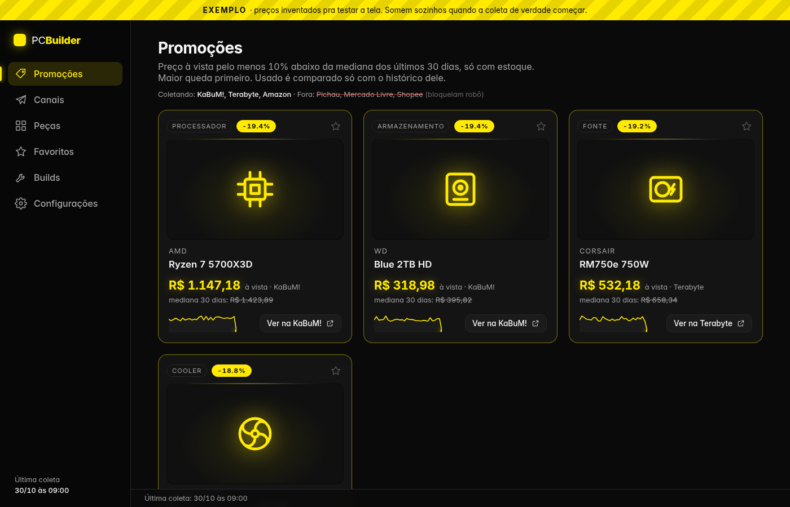
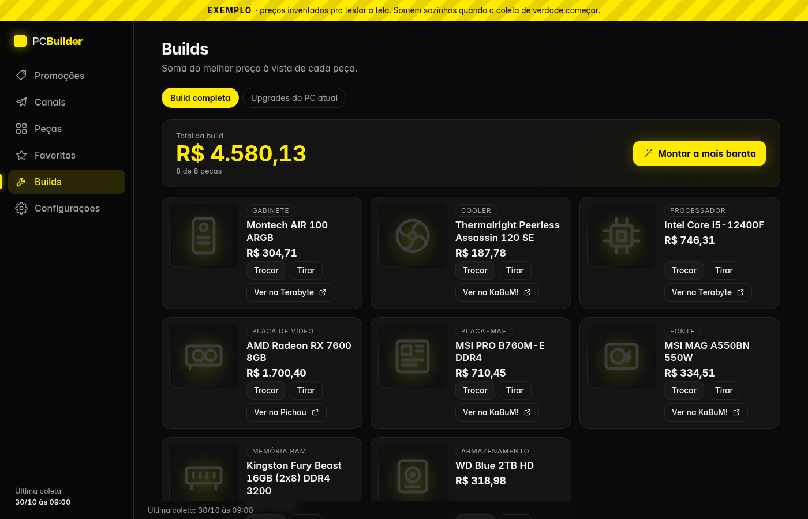
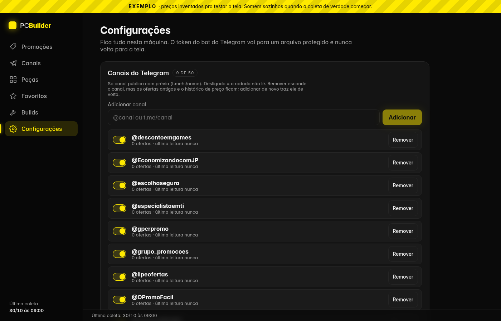

# PC Builder

[English](README.md) · **Português (Brasil)**

Dashboard local (roda na sua máquina) que acompanha preços de peças de PC em lojas brasileiras e em canais
públicos de promoção do Telegram, guarda o histórico e destaca promoção de verdade (preço abaixo da mediana de
30 dias). Também monta a build completa mais barata e compatível e lista upgrades compatíveis com o seu PC atual.
Tela escura, interface bilíngue em português e inglês (selecionável em Configurações > Idioma; padrão pt-BR; mensagens do backend continuam em português).

A tela de **Configurações** (ícone de engrenagem) controla canais, lojas, o seu PC atual, faixa de preço, o aviso
pelo seu bot do Telegram, o agendador interno e o idioma. Roda local, com Docker compose ou agendado por um
Hermes Agent (veja [docs/HERMES.md](docs/HERMES.md)).

## Telas

Dados de exemplo (o app começa com um banco de exemplo até o primeiro preço real ser coletado).

| Promoções | Builds |
|---|---|
|  |  |



## Arquitetura

```
 lojas (KaBuM!, Terabyte, Amazon)         canais públicos do Telegram (t.me/s/<canal>)
            │  app.collect (agendado)               │  app.tg (agendado, a cada ~45 min)
            ▼                                       ▼
      lê o preço ──► app.ingest ──►  SQLite (data/pcbuilder.db)  ◄── classifica o tipo
                                                    │                 (regras + Ollama local opcional)
                                                    ▼
                    FastAPI (API só de leitura + builds/favoritos) em 127.0.0.1:8787
                                                    │
                                                    ▼
                                 Tela React + Vite (servida pelo backend)
```

- **Preço nunca entra pela API HTTP**: só o comando local `app.ingest` e os coletores gravam preço.
- A IA (opcional, Ollama local) só diz o *tipo* do item; preço e "mesmo produto" são regras simples e testadas.
- O aviso sai pelo destino escolhido na tela: o **seu bot do Telegram**, a **saída do script** (stdout; quem
  agenda entrega, ex.: cron ou Hermes Agent) ou nenhum. Saída vazia = nada a avisar.

## Requisitos

- Linux ou macOS, Python 3.11 e [uv](https://docs.astral.sh/uv/)
- Node.js 20+ e npm (para gerar a tela)
- Opcional: [Ollama](https://ollama.com/) com modelos pequenos, para o classificador dos canais do Telegram. Sem
  ele, o app usa regras (veja "IA local" abaixo)

## Rodar local

```sh
git clone <url-do-repositorio> pc-builder && cd pc-builder
cd frontend && npm ci && npm run build && cd ..
cd backend && uv sync && uv run python -m app.serve
```

Abra <http://127.0.0.1:8787>. Até a primeira coleta real, o app mostra **dados de exemplo** (faixa amarela
"EXEMPLO"). Para coletar preços de verdade:

```sh
cd backend
uv run python -m app.collect --dry-run     # lojas: mostra o que gravaria
uv run python -m app.collect               # lojas: grava
uv run python -m app.tg                    # canais do Telegram
```

As variáveis opcionais estão no `.env.example`.

## Receber os avisos no Telegram

Tudo pela tela, em **Configurações → Notificação**:

1. No Telegram, abra o **@BotFather** e mande `/newbot`. Escolha um nome; ele responde com o **token** do bot
   (uma linha com números, dois-pontos e umas 35 letras/números).
2. Cole o token no campo "Token do bot" e clique em **Salvar**. A tela passa a mostrar só "configurado (termina em
   …1234)": o token fica no arquivo `data/secrets.env` (modo 0600), nunca no banco e nunca volta pela API.
3. Abra o seu bot no Telegram e mande `/start`.
4. Clique em **Encontrar meu chat** e escolha a sua conversa. Depois, **Enviar mensagem de teste**.
5. Em "Destino do aviso", escolha **Bot do Telegram** e salve.

Prefere não colar o token na tela? Defina `PCB_TELEGRAM_TOKEN` e `PCB_TELEGRAM_CHAT_ID` no ambiente do serviço
(vale mais que o arquivo; o campo fica bloqueado).

## IA local (Ollama): opcional, pode ligar depois

Sem Ollama, o tipo das ofertas dos canais vem de **regras** (acertam 99,7% nos exemplos rotulados à mão, número
otimista: as amostras são pequenas e as regras foram ajustadas nelas). Para usar a IA, sem reinstalar nada:

1. Instale o Ollama ([ollama.com/download](https://ollama.com/download)) e deixe-o rodando.
2. Em **Configurações → IA local (Ollama)**, confira se aparece "Ollama responde" (endereço padrão
   `http://127.0.0.1:11434`; mude e clique em **Testar** se o seu for outro).
3. Em "Baixar outro modelo", baixe um modelo (a barra mostra o progresso) e marque de 1 a 3 na lista. **Salvar modelos**.
4. Deixe o modo em **Automático**: o app usa a IA quando o Ollama responde e volta para as regras sozinho se ele
   cair (avisa uma vez; quando voltar, reavalia o que as regras classificaram).

Modelos sugeridos (os testados): `qwen2.5:3b` (~2 GB), `llama3.2:3b` (~2 GB), `gemma3:4b` (~3,3 GB). Com 1 modelo
ele decide sozinho; com 2, os dois têm de concordar; com 3, vale a maioria (o mais preciso nos testes). Um modelo
por vez fica na placa de vídeo: conte com uns 3 a 5 GB de memória de vídeo para esses (o que não couber o Ollama
roda na CPU); sem placa, roda tudo na CPU (bem mais lento, ~2 a 7 s por anúncio num PC de mesa comum). O "Teste rápido" da tela mostra o tipo de um título colado e de onde ele veio.

## Quem roda a coleta: dois modos (escolha um)

- **Agendador interno** (sem cron): em **Configurações → Coleta**, ligue "Agendador interno" (ou `PCB_SCHEDULER=1`).
  O próprio servidor (`app.serve`) roda a coleta das lojas e a rodada dos canais a cada "Coletar a cada" minutos e
  manda os avisos pelo destino escolhido. "Rodar agora" faz uma rodada na hora.
- **Agendador externo** (cron, timer do systemd, Hermes Agent): deixe o agendador interno **desligado** (senão
  roda em dobro) e agende `deploy/coleta-diaria.sh` e `deploy/canais-telegram.sh`. Com o destino **Saída do
  script**, a mensagem sai no stdout e quem agenda entrega; com **Bot do Telegram**, o app manda sozinho e a saída
  fica vazia. Modelo de serviço systemd de usuário: `deploy/pc-builder.service`.

Nos dois modos, uma trava de arquivo (`data/rodada.lock`) impede duas rodadas ao mesmo tempo. O **modo jogo**
(na tela ou `PCB_GAME_MODE=1`) pula a rodada com jogo aberto (só na instalação local, não no Docker).

O servidor só escuta em `127.0.0.1` (no Docker ele escuta em `0.0.0.0` *dentro do container* e o compose publica só
no `127.0.0.1` do host: veja "Docker"). Para abrir de outro aparelho, use um proxy reverso local (ex.:
`tailscale serve`, dentro de uma rede privada). Nunca publique em `0.0.0.0` sem proxy nem exponha à internet.
Toda requisição que grava (configurações, token, canais, builds, favoritos) precisa de um `Host` permitido e, se vier,
de um `Origin` permitido (padrão `127.0.0.1:8787` e `localhost:8787`); ponha o nome do seu proxy em
`PCB_ALLOWED_HOSTS`, senão salvar pelo outro aparelho dá 403.

## Docker

Precisa do Docker com o plugin compose. Não precisa de Python, Node nem uv no computador.

```sh
git clone <url-do-repositorio> pc-builder && cd pc-builder
cp .env.example .env          # opcional: sem .env também sobe
docker compose up -d --build
```

Abra <http://127.0.0.1:8787>. O agendador interno vem **ligado** no Docker (`PCB_SCHEDULER=1`); ponha
`PCB_SCHEDULER=0` no `.env` para desligar. Os logs: `docker compose logs -f pc-builder`.

- **Onde ficam os dados:** no volume nomeado `pcb-data`, montado em `/data` (`PCB_DATA_DIR`): banco, fotos dos
  canais, `secrets.env` (modo 0600), `agendador.json`, `rodada.lock`. O volume nasce com o dono do usuário do
  container (UID 10001, sem root), então funciona do zero, sem `sudo` nem `chmod`. Nada de `data/`, `.env` ou
  segredo é copiado para a imagem (veja o `.dockerignore`).
- **Parar / ligar / atualizar:**
  ```sh
  docker compose stop            # para (mantém tudo)
  docker compose down            # remove o container; o volume de dados fica
  git pull && docker compose up -d --build   # atualiza; os dados ficam
  docker compose down -v         # APAGA o volume de dados (banco, token): só se for isso mesmo
  ```
- **Backup do volume** (um tar.gz na pasta atual; usa a imagem pequena `alpine`):
  ```sh
  docker compose stop
  docker run --rm -v pc-builder_pcb-data:/data:ro -v "$PWD":/backup alpine tar czf /backup/pcb-data.tar.gz -C /data .
  docker compose start
  ```
  O nome do volume é `<projeto>_pcb-data`; confira com `docker volume ls` (o projeto é o nome da pasta). Para
  restaurar, pare o app e extraia o arquivo de volta no volume com o mesmo padrão de comando.
- **Endurecimento já ligado:** usuário sem root, sistema de arquivos `read_only` (grava só em `/data` e num `tmpfs`
  em `/tmp`), `cap_drop: [ALL]`, `no-new-privileges`, rotação de log (3 × 10 MB), `healthcheck` da imagem em
  `/api/health`.
- **Só o loopback do host:** o container escuta em `0.0.0.0` (senão a porta publicada não o alcança), mas o compose
  publica `127.0.0.1:8787:8787`. **Não troque por `8787:8787`.** Preço continua não entrando pela API, e a trava de
  escrita (Host/Origin/Content-Type) é a mesma de fora do Docker.
- **Modo jogo** não existe no Docker (o container não enxerga os seus processos); a tela avisa.

### Bot do Telegram no Docker

Ou pela tela (**Configurações → Notificação**; grava `/data/secrets.env`, modo 0600, no volume) ou no `.env` com
`PCB_TELEGRAM_TOKEN` e `PCB_TELEGRAM_CHAT_ID` (valem mais que o arquivo e o campo fica só leitura). Nunca faça
commit do `.env`.

### Ollama (perfil opcional)

```sh
docker compose --profile ollama up -d
```

Sobe também um container `ollama/ollama`, com volume próprio para os modelos. Ele **não publica porta** no host:
só o app o alcança, pela rede do compose, em `http://ollama:11434`. Diga ao app onde ele está: no `.env`
(`PCB_OLLAMA_URL=http://ollama:11434` e, se quiser, `COMPOSE_PROFILES=ollama` para o `docker compose up -d` simples
já subir o Ollama; o campo aparece travado pela variável de ambiente) ou digitando esse endereço em
**Configurações → IA local (Ollama)** e clicando em **Testar**/**Salvar**. Depois baixe um modelo na mesma tela (a
barra mostra o progresso). **Sem GPU o Ollama é lento**; nesse caso o classificador por regras é o recomendado
(Configurações → IA local → "Só regras"). Para GPU NVIDIA, tire o comentário do bloco
`deploy.resources.reservations.devices` no `docker-compose.yml` (precisa do NVIDIA Container Toolkit no host). A
imagem oficial do Ollama roda como root dentro do container dela; não tem porta publicada nem acesso aos seus
arquivos.

### Abrir de outro aparelho (por sua conta e risco)

Mantenha a publicação em `127.0.0.1` e ponha um proxy reverso **no host** na frente (ex.: `tailscale serve`, Caddy ou
nginx com autenticação, dentro de uma rede privada). Ponha o nome que o navegador usa em `PCB_ALLOWED_HOSTS` no
`.env` (comparação exata, ex.: `pc.minha-rede.example`), senão salvar dá 403. Nunca publique a porta em `0.0.0.0`
sem proxy nem exponha à internet.

### Variáveis que importam no Docker

| Variável | Padrão no Docker | Para que serve |
|---|---|---|
| `PCB_HOST` | `0.0.0.0` (definida pela imagem) | Endereço de escuta; fora do Docker o padrão é `127.0.0.1`. Valor inválido = `127.0.0.1` |
| `PCB_IN_DOCKER` | `1` (definida pela imagem) | Desliga o modo jogo e avisa a tela que está no Docker |
| `PCB_DATA_DIR` | `/data` | Banco, fotos, `secrets.env`, estado e trava do agendador |
| `PCB_SCHEDULER` | `1` (compose) | Agendador interno ligado/desligado |
| `PCB_ALLOWED_HOSTS` | vazio | Nomes extras de `Host`/`Origin` que podem gravar (o seu proxy) |
| `PCB_PANEL_URL` | `http://127.0.0.1:8787` | Link no fim dos avisos |
| `PCB_TELEGRAM_TOKEN`, `PCB_TELEGRAM_CHAT_ID` | vazio | Bot (valem mais que o `secrets.env` da tela) |
| `PCB_OLLAMA_URL`, `PCB_OLLAMA_MODELS` | vazio | Endereço / modelos do Ollama (`http://ollama:11434` com o perfil) |
| `PCB_CLASSIFIER` | `auto` | `auto`, `rules` ou `ollama` |
| `PCB_COLLECT_EVERY_MINUTES`, `PCB_STORES`, `PCB_NOTIFY_TARGET`, `PCB_CURRENT_PC` | o valor da tela | Veja o `.env.example` |

## Testes

```sh
cd backend && uv run python -B -m pytest -q     # backend
cd frontend && npx vitest run                   # frontend
python3 tools/check_public.py                   # higiene pública: nada de dado pessoal ou segredo no repositório
```

## Documentação

Documentação completa em português em [docs/](docs/) e em inglês em [docs/en/](docs/en/):

- [Banco de dados](docs/01-banco-de-dados.md): tabelas, consultas, regras de projeto.
- [Backend e API](docs/02-backend.md): endpoints, trava de escrita, por que o preço não entra pela rede.
- [Frontend](docs/03-frontend.md): telas, tela de configurações, modo exemplo.
- [Coleta de preços](docs/04-coleta-de-precos.md): lojas aceitas, como o coletor funciona, agendamento.
- [Canais do Telegram](docs/05-canais-telegram.md): leitura de canais públicos, classificação e aviso.
- [Hermes Agent](docs/HERMES.md): agendar com um cron do Hermes Agent (opcional).

## Aviso sobre scraping

Ler preço do site das lojas pode **quebrar a qualquer momento** (os sites mudam) e **pode violar os termos de uso**
do site. Este projeto é para **uso pessoal**, em volume baixo, e não contorna captcha, proteção anti-robô nem login;
loja que bloqueia acesso automático simplesmente fica de fora. **A responsabilidade pelo uso é de quem usa.**
O projeto **não é afiliado** a nenhuma loja nem ao Telegram.

## Como reportar problema

Abra uma issue no repositório dizendo o que fez, o que esperava e o que aconteceu (log ajuda). **Nunca cole token,
senha ou dado pessoal numa issue.** Problema de segurança: veja o [SECURITY.md](SECURITY.md). Para contribuir:
[CONTRIBUTING.md](CONTRIBUTING.md).

## Licença

[MIT](LICENSE) © 2026 gilas-byte
